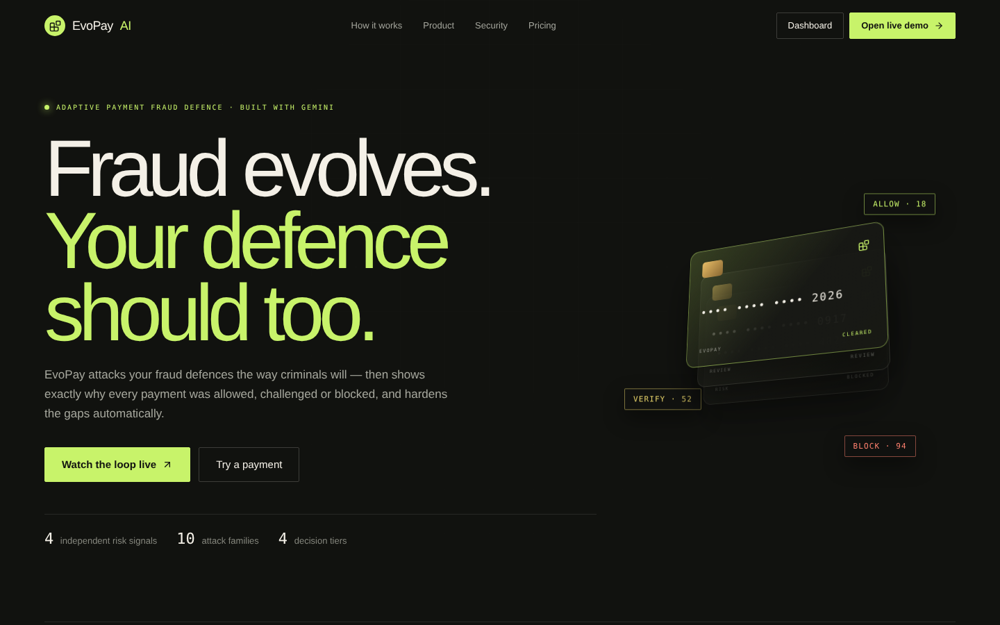
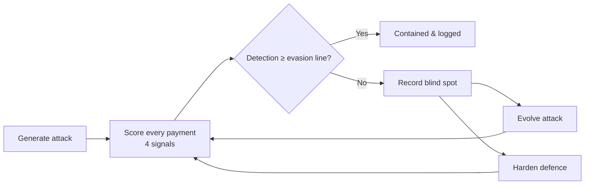
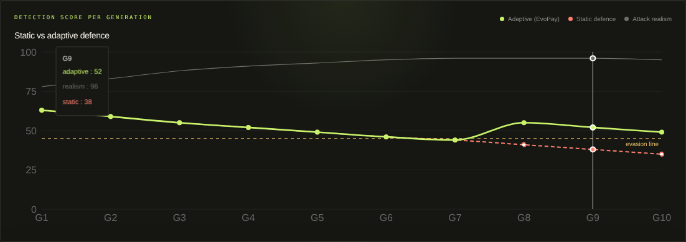
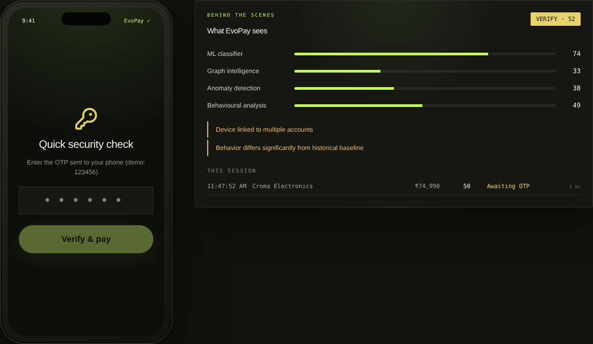
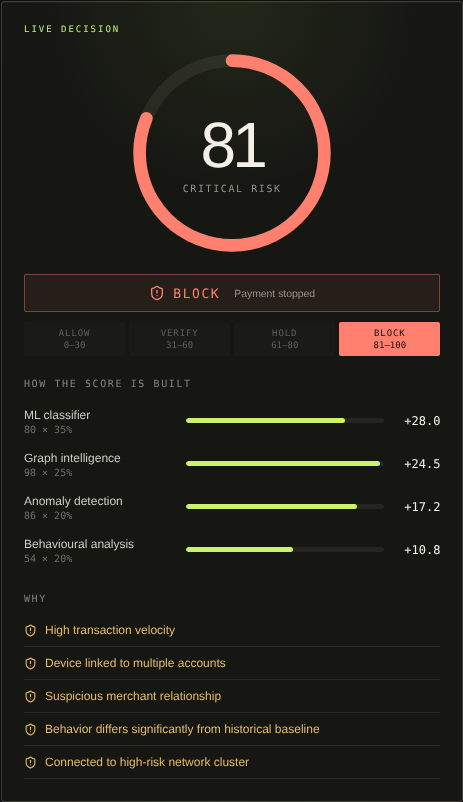
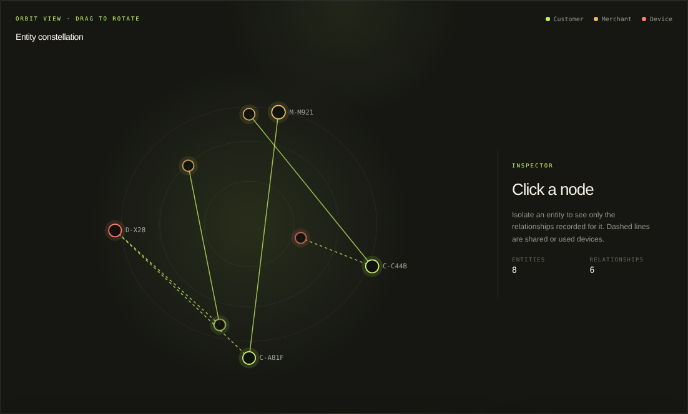
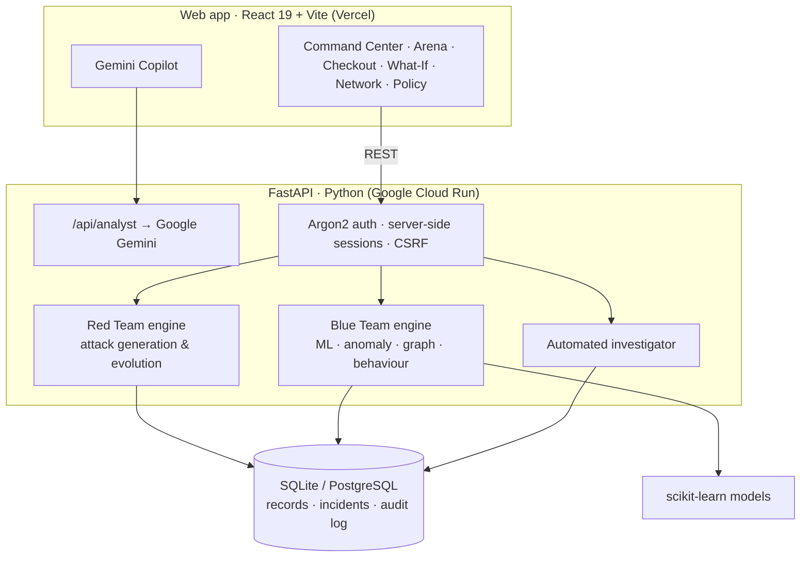

<div align="center">

# EvoPay AI

### Adaptive payment fraud defence

**Fraud evolves. Your defence should too.**

[](https://evopay-dun.vercel.app)
[](#built-with-google-gemini)



</div>

---

## The problem

India's payment rails move at a scale no human team can review. UPI alone processed **25.47 billion transactions worth ₹31.53 lakh crore in October 2026** — more than ₹1 lakh crore every day ([NPCI data via Free Press Journal](https://www.freepressjournal.in/business/upi-transactions-hit-2547-billion-in-october-value-soars-to-3153-lakh-crore)). Every one of those payments needs an allow / challenge / block decision in milliseconds.

At the same time, the money at stake keeps climbing: banks reported frauds involving **₹48,021 crore in FY26, up 46% year-on-year and a three-year high** ([RBI Annual Report 2025-26 via The Statesman](https://www.thestatesman.com/business/bank-fraud-cases-reduced-in-fy26-but-total-amount-highest-in-three-years-rbi-data-1503599710.html)).

Most fraud models are trained and tested on **historical** patterns — but attackers adapt every week. A detector that looks great on last year's fraud can be blind to this week's variant, and when it does block a payment, analysts and customers rarely learn *why*.

## The solution

EvoPay runs a continuous **Red Team vs Blue Team loop** against your fraud defences:

| | | |
|---|---|---|
| **1 · Attack** | **2 · Detect** | **3 · Adapt** |
| A Red Team engine generates realistic fraud across 10 attack families and *evolves* each one to be harder to catch. | Every payment is scored 0–100 by four independent signals and given an explainable decision. | When an attack slips through, the blind spot is recorded, the attack evolves again, and the defence is hardened. |



---

## Product tour

| Feature | What it does |
|---|---|
| **Evolution Arena** | Watch one attack family mutate generation by generation. A static defence slowly goes blind; EvoPay's adaptive defence records each blind spot and recovers. |
| **Live Checkout** | The customer's view: a UPI checkout scored in real time — instant approval, OTP step-up, review, or decline. Tapping *Pay* repeatedly looks like card testing and gets challenged. |
| **What-If Lab** | Move any payment signal and watch the score, decision and reasons update instantly. |
| **3D Fraud Network** | Rotate the entity graph of customers, merchants and devices; click a node to isolate its links and expose shared-device mule rings. |
| **Policy Backtester** | Change the Allow / Verify / Hold / Block thresholds and replay them over recorded payments to see exactly what would change — before touching production. |
| **Gemini Copilot** | Ask questions about live payments and incidents; get grounded investigation briefs and plain-English explanations. |
| **Command Center, Incidents & Alerts** | Live posture, rupee value protected, an incident queue with audit trail, an alerts centre, and CSV export. |
| **Developer console** | Integration guide with a live API console and cURL / JavaScript / Python snippets. |

<table>
<tr>
<td width="50%"><br/><sub><b>Evolution Arena</b> — static defence (red) falls below the evasion line; adaptive defence (green) recovers.</sub></td>
<td width="50%"><br/><sub><b>Live Checkout</b> — a large purchase on a new device triggers an OTP step-up.</sub></td>
</tr>
<tr>
<td width="50%"><br/><sub><b>What-If Lab</b> — the four-signal breakdown behind a BLOCK decision.</sub></td>
<td width="50%"><br/><sub><b>3D Fraud Network</b> — drag to orbit, click to isolate relationships.</sub></td>
</tr>
</table>

---

## How the risk engine decides

Each payment is scored by four independent signals and combined into one 0–100 risk score:

| Signal | Weight | Looks at |
|---|---|---|
| ML classifier (HistGradientBoosting) | 35% | amount deviation, failed attempts, velocity and engineered features |
| Graph intelligence | 25% | links to high-risk entities, shared devices, suspicious relationships |
| Anomaly detection (Isolation Forest) | 20% | unusual velocity, device sharing and failure patterns |
| Behavioural analysis | 20% | deviation from the customer's spending baseline, location change, merchant concentration |

| Score | Decision | Customer experience |
|---|---|---|
| 0 – 30 | **ALLOW** | Payment goes straight through |
| 31 – 60 | **VERIFY** | Step-up check (OTP) |
| 61 – 80 | **HOLD** | Sent to the analyst queue |
| 81 – 100 | **BLOCK** | Payment stopped, incident opened |

Every decision carries the reasons that drove it (e.g. *"Device linked to multiple accounts"*, *"Behaviour differs significantly from historical baseline"*).

On a held-out test set of 10,000 transactions from our generator, the current classifier (v1.0) reaches 99.45% precision and 99.78% recall (`backend/ml/models/metrics.json`). We treat this as a baseline only — the point of EvoPay is that static benchmarks are not enough.

---

## Built with Google Gemini

EvoPay's analyst copilot is powered by **Google Gemini**, called from the backend (`backend/services/analyst.py`):

- **Investigation briefs** for any transaction
- **"Why was this blocked?"** explanations in plain English
- **Attack-run summaries** for risk committees
- **Copilot chat** over live payments and incidents

Gemini only sees the workspace's own data and is instructed never to invent figures. The API key lives in Google Secret Manager and only signed-in users can call the analyst. If no key is configured, EvoPay falls back to a built-in rule-based analyst so the product never breaks.

---

## Architecture



## Security model

- **Argon2** password hashing
- **Server-side sessions** in an `httpOnly` cookie — tokens never touch browser storage
- **CSRF protection** on every state-changing request
- **Strict record ownership** — each analyst's workspace is isolated
- **Audit trail** for every decision, action and investigation
- **Gemini key in Google Secret Manager**, analyst available to signed-in users only

## Tech stack

**Frontend:** React 19, TypeScript, Vite, Framer Motion, Recharts, Tailwind CSS
**Backend:** FastAPI, Python 3.12, scikit-learn, pandas, SQLite / PostgreSQL
**AI:** Google Gemini (analyst copilot), HistGradientBoosting + Isolation Forest (detection)
**Hosting:** Vercel (web app) + Google Cloud Run (API, Mumbai) + Google Secret Manager (Gemini key). Vercel forwards `/api/*` to Cloud Run, so the browser talks to one domain.

---

## Getting started

### Prerequisites
- Node.js 18+ (20 or 24 recommended)
- Python 3.10+ (3.12 tested)

### 1. Clone
```bash
git clone https://github.com/6289subhasree/evopay.git
cd evopay
```

### 2. Backend
```bash
cd backend
python -m venv venv
source venv/bin/activate        # Windows: venv\Scripts\activate
pip install -r requirements.txt
python init_db.py               # create and seed the database
uvicorn main:app --reload --port 8000
```
API: `http://localhost:8000` · Interactive docs: `http://localhost:8000/docs`

### 3. Frontend
```bash
cd frontend
npm install
cp .env.example .env            # VITE_API_URL=http://127.0.0.1:8000/api
npm run dev
```
App: `http://localhost:5173`. Without a running backend the app falls back to built-in demo data, so the UI is always explorable.

### 4. Enable Gemini (optional)
Create a key in [Google AI Studio](https://aistudio.google.com) and add it to your Vercel project as `GEMINI_API_KEY` (Settings → Environment Variables). Optionally set `GEMINI_MODEL` (default `gemini-3.5-flash-lite`).

### 5. Deploy on Google Cloud
One command deploys the API to **Google Cloud Run** (Gemini key in **Secret Manager**) and connects the Vercel web app to it:

```powershell
.\deploy\deploy-google.ps1 -ProjectId YOUR_PROJECT_ID      # Windows
```
```bash
./deploy/deploy-google.sh YOUR_PROJECT_ID                  # macOS / Linux / Cloud Shell
```
Full guide, configuration and troubleshooting: **[DEPLOY_GOOGLE_CLOUD.md](DEPLOY_GOOGLE_CLOUD.md)**.

### Tests
```bash
cd backend
python -m pytest tests
```

---

## Roadmap

- Pilots on anonymised partner transaction streams
- Automatic model retraining when a blind spot is confirmed
- UPI-specific attack families (collect-request scams, QR swaps, mule onboarding)
- Cloud SQL for PostgreSQL for multi-instance production deployments
