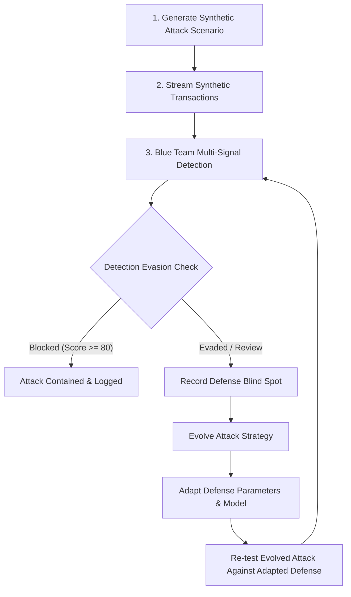
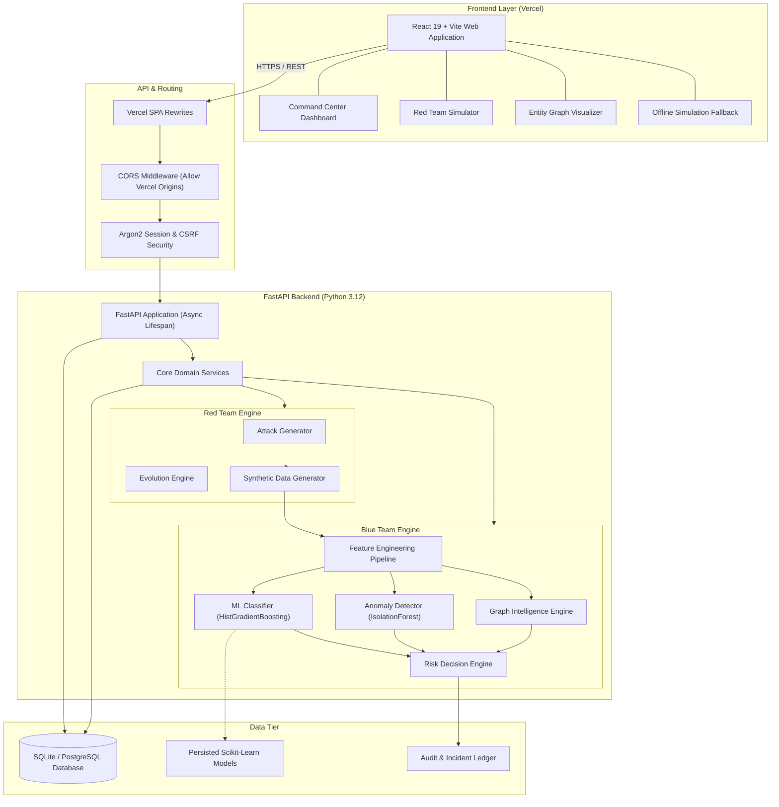
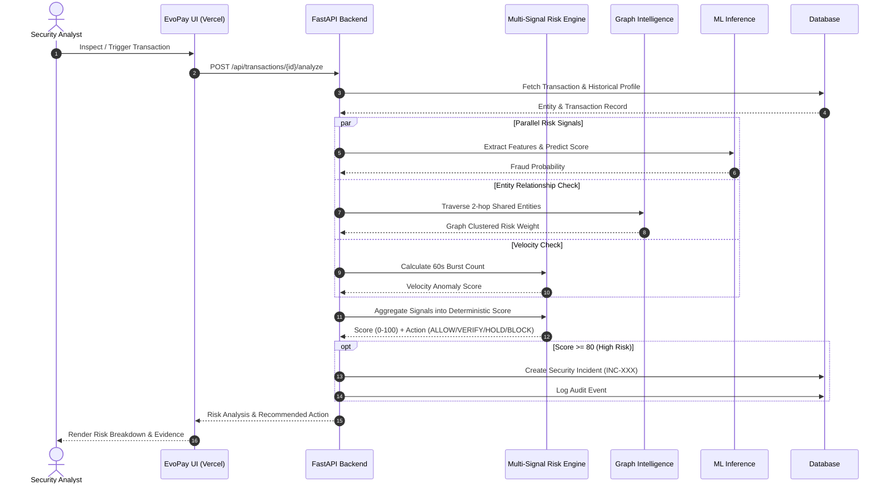
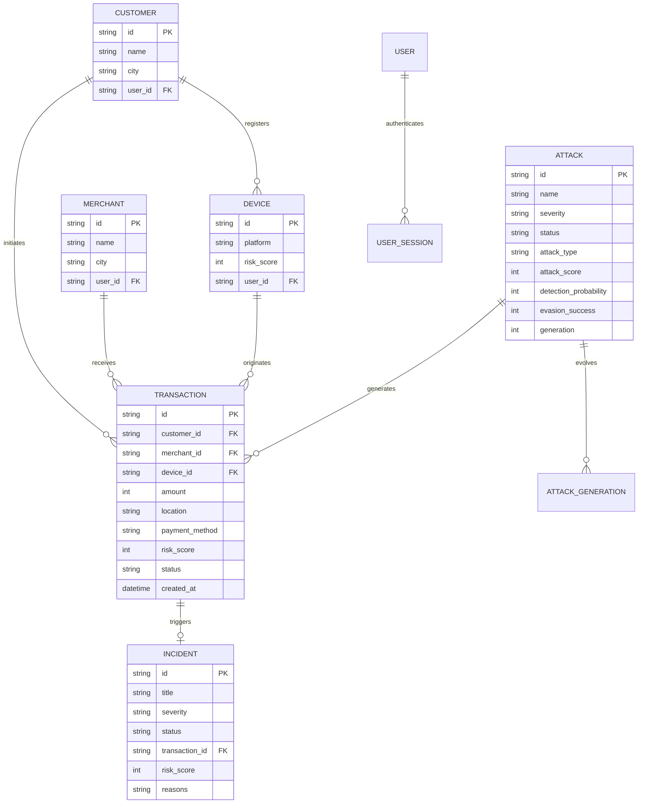

# EvoPay AI

### Adversarial AI for Payment Fraud Detection

[](https://evopay-dun.vercel.app)
[](https://evopay-dun.vercel.app)
[](LICENSE)

EvoPay AI is a security research and simulation platform that models payment fraud as an **adversarial problem**.

Instead of testing a fraud detector only against static historical patterns, EvoPay introduces a controlled **Red Team vs Blue Team** loop: synthetic attacks are generated, evaluated against an ensemble detection system, evolved when they evade detection, and used to identify potential defense blind spots.

> **Fraud evolves. Your defense should too.**

---

## 🌐 Live Application

* **Production URL:** [https://evopay-dun.vercel.app](https://evopay-dun.vercel.app)
* **Preview Deployment:** [https://evopay-3sw3bv5xs-subhasree-pauls-projects.vercel.app](https://evopay-3sw3bv5xs-subhasree-pauls-projects.vercel.app)
* **Simulation Mode:** Interactive offline demo mode enabled out-of-the-box with pre-seeded synthetic attack scenarios, transactions, entity graph, and defense analytics.

---

## Overview

Generative AI makes fraudulent behavior easier to vary, automate, and scale. Traditional fraud systems are often evaluated against historical static datasets, while adversarial attackers continuously adapt their techniques.

EvoPay explores an adaptive counter-defense loop:



> **Note:** The entire platform operates strictly on **synthetic payment data** designed for controlled security experimentation. No real payment credentials, card numbers, or live banking networks are connected.

---

## Key Features

### 🔴 Red Team (Adversarial Engine)
Generate controlled synthetic fraud scenarios across multiple attack vectors:
* **Synthetic Identity**: Blending real and fabricated identity signals.
* **Account Takeover**: Simulating sudden behavioral, device, and location deviations.
* **Card Testing**: High-velocity authorizations with micro-amounts and card number variation.
* **Money Mule Network**: Dispersed origin transactions converging into centralized destination nodes.
* **Merchant Collusion**: Clustered routing to suspicious or freshly registered merchant entities.
* **Behavioral Mimicry**: Synthetic fraud designed to emulate standard consumer spending distributions.
* **Device Rotation**: High account-to-device switching ratios.
* **Refund Abuse**: Disproportionate refund-to-purchase ratios.
* **Velocity Attacks**: Burst authorizations within narrow time windows.
* **Composite Attacks**: Multi-stage combined vectors designed to evade single-heuristic defenses.

### 🔵 Blue Team (Defense Operations)
Evaluates each incoming transaction using an ensemble of independent signals rather than a single static threshold:
* **Machine Learning Classifier**: Supervised classification predicting fraud probability.
* **Anomaly Detection**: Unsupervised behavioral deviation scores via Isolation Forest heuristics.
* **Behavioral Analysis**: Spending frequency, amount entropy, and temporal deviation against baseline profiles.
* **Graph Intelligence**: Multi-hop entity graph analysis mapping customer, device, IP, and merchant associations.
* **Velocity Metrics**: Rolling 1-minute and 10-minute transaction bursts.

```text
Decision Matrix:
  0 – 30   → ALLOW
 31 – 60   → VERIFY (Step-up Authentication)
 61 – 80   → HOLD (Analyst Queue)
 81 – 100  → BLOCK (Automated Containment)
```

### 🧠 Adaptive Defense Loop
When an attack successfully evades detection, EvoPay logs the scenario as a **Defense Blind Spot**, updates feature weights, recalibrates thresholds, and re-evaluates the defense posture.

### 🕸️ Entity Graph Intelligence
Models relational topologies across:
`Customer ↔ Account ↔ Device ↔ Merchant ↔ Transaction`

---

## System Architecture



---

## Transaction Analysis Sequence



---

## Entity Relationship Model



---

## Repository Structure

```text
evopay/
├── backend/
│   ├── ml/                               # Machine learning pipelines
│   │   ├── models/                       # Pre-trained classifier and anomaly models
│   │   ├── data_generator.py             # Synthetic transaction data synthesizer
│   │   ├── evaluate.py                   # Model evaluation metrics (F1, AUC, Recall)
│   │   ├── feature_engineering.py        # Tabular feature transformation
│   │   ├── predict.py                    # Inference wrapper
│   │   └── train.py                      # Training script for HistGradientBoosting
│   ├── services/
│   │   ├── attack_engine.py              # Red Team generation & genetic evolution
│   │   ├── investigator.py               # Automated incident evidence analysis
│   │   └── risk_engine.py                # Multi-signal deterministic scoring engine
│   ├── tests/
│   │   └── test_api.py                   # Pytest suite with isolated test client
│   ├── auth.py                           # Argon2 password hashing & session security
│   ├── database.py                       # SQLite / PostgreSQL schema & demo seeding
│   ├── init_db.py                        # Database migration & bootstrap script
│   ├── main.py                           # FastAPI application & CORS configuration
│   ├── models.py                         # SQLAlchemy database models
│   ├── requirements.txt                  # Python runtime dependencies
│   ├── run_tests.py                      # Test runner
│   └── schemas.py                        # Pydantic request / response contracts
│
├── frontend/
│   ├── src/
│   │   ├── layouts/
│   │   │   └── AppShell.tsx              # Application layout & navigation
│   │   ├── lib/
│   │   │   ├── api.ts                    # Typed API client with auto-simulation fallback
│   │   │   └── mockData.ts               # Standalone demo data provider
│   │   ├── pages/
│   │   │   ├── Analytics.tsx             # Posture metrics & model tracking
│   │   │   ├── Auth.tsx                  # Analyst sign-in & registration
│   │   │   ├── BlueTeam.tsx              # Detection inspection & rule tuning
│   │   │   ├── Dashboard.tsx             # Command center & threat feeds
│   │   │   ├── Incidents.tsx             # Incident management & triage
│   │   │   ├── Network.tsx               # Entity relationship graph
│   │   │   ├── Settings.tsx              # Workspace configurations
│   │   │   ├── Simulation.tsx            # Attack execution & evasion tracking
│   │   │   └── Transactions.tsx          # Real-time transaction stream
│   │   ├── App.tsx                       # Client-side router & session provider
│   │   ├── main.tsx                      # React root entry
│   │   └── index.css                     # Glassmorphic UI stylesheet
│   ├── package.json                      # Frontend dependencies
│   ├── tsconfig.json                     # TypeScript configuration
│   ├── vercel.json                       # Subfolder SPA rewrites
│   └── vite.config.ts                    # Vite build configuration
│
├── package.json                          # Monorepo build scripts for Vercel
├── vercel.json                           # Root Vercel deployment configuration
├── DEPLOYMENT.md                         # Full deployment documentation
├── .env.example                          # Root environment template
├── .gitignore                            # Git ignore rules
└── README.md                             # Project documentation
```

---

## Tech Stack

| Layer | Technologies |
| :--- | :--- |
| **Frontend** | React 19, TypeScript, Vite, Tailwind CSS, Framer Motion, Recharts, Lucide Icons |
| **Backend** | Python 3.12, FastAPI, Starlette, Pydantic v2, SQLAlchemy |
| **Security & Auth** | Argon2-cffi, SHA-256 session token hashing, CSRF Double-Submit cookies |
| **Machine Learning** | Scikit-learn (HistGradientBoosting, IsolationForest), Pandas, NumPy |
| **Database** | SQLite (zero-config local dev & demo) / PostgreSQL compatible |
| **Hosting & CI/CD** | Vercel (Frontend CDN & Edge Network), Render / Railway (Backend) |

---

## Getting Started

### Prerequisites
* **Node.js**: 18+ (Node 20 or 24 recommended)
* **Python**: 3.10+ (Python 3.12 tested)
* **Git**

### 1. Clone the Repository
```bash
git clone https://github.com/6289subhasree/evopay.git
cd evopay
```

### 2. Backend Setup
```bash
cd backend

# Create virtual environment
python -m venv venv

# Activate virtual environment
# Windows:
venv\Scripts\activate
# macOS/Linux:
source venv/bin/activate

# Install dependencies
pip install -r requirements.txt

# Bootstrap and seed the database
python init_db.py

# Start FastAPI server
uvicorn main:app --reload --port 8000
```
* Backend API: `http://localhost:8000`
* Interactive OpenAPI Docs: `http://localhost:8000/docs`

### 3. Frontend Setup
In a new terminal window:
```bash
cd frontend

# Install dependencies
npm install

# Start development server
npm run dev
```
* Web Application: `http://localhost:5173`

---

## Running Backend Tests

```bash
cd backend
python run_tests.py
```
Or directly with pytest:
```bash
pytest tests/test_api.py -v
```

---

## Deployment

Detailed deployment instructions for Vercel and Render are available in [DEPLOYMENT.md](DEPLOYMENT.md).

### Quick Vercel Deploy (Frontend)
1. Fork or push to GitHub.
2. In [Vercel Dashboard](https://vercel.com/dashboard), import your repository.
3. Root `vercel.json` and `package.json` will automatically build the Vite application and configure SPA route rewrites.
4. Set `VITE_API_URL` to your backend URL (or leave default to use the built-in interactive demo mode).

---

## Security Model

* **Synthetic Data Only**: All customer names, card numbers, accounts, and transactions are procedurally synthesized. No real payment network is contacted.
* **Deterministic Risk Actions**: Model probabilities feed into auditable deterministic threshold rules. Machine learning scores inform decisions but never take un-audited autonomous actions.
* **Analyst Workspace Isolation**: User accounts maintain segregated session partitions and database ownership.

---

<p align="center">
  <strong>EvoPay AI</strong> — Adversarial Defense for Evolving Payment Fraud<br>
  Live at <a href="https://evopay-dun.vercel.app">evopay-dun.vercel.app</a>
</p>
